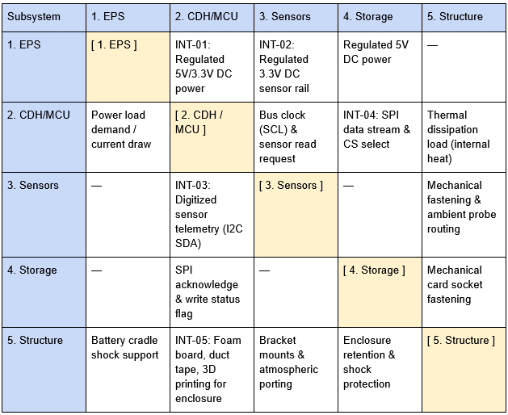

# Designing a Payload

Every successful aerospace mission begins not with soldering irons or raw code, but with a question: What is this mission trying to achieve? In aerospace and systems engineering, requirements drive design. You cannot select a microcontroller, choose a battery, or size an enclosure until you know what the system is required to do and what constraints it must operate within.

## 1. Requirements Drive Design

Before writing requirements, start by examining your goals and physical boundaries:

1. What is the payload’s objective? Ask yourself what primary questions your mission will answer. High-altitude balloons carry payloads to the edge of space, but the scientific or operational focus dictates every subsystem you choose. Your scientific or engineering objective establishes your functional and performance requirements—defining exactly what tasks the hardware must execute and how accurately it must measure. Below are some examples of payload projects to think about:
   - Atmospheric Characterization: Are you measuring vertical temperature gradients, pressure decay, or humidity profiles as you ascend through the troposphere and stratosphere?
   - Visual Imagery: Are you capturing wide-angle video or high-resolution stills of the curvature of the Earth and the blackness of space?
   - Remote Sensing & Experiments: Are you testing solar panel degradation, radiation exposure, or custom RF transmitters?
2. Flight providers, balloon launch operators, and aviation authorities define constraints that your system cannot violate.
   - Mass Ceilings: Balloon ascent profiles and aviation regulations place strict mass caps on individual packages (often requiring payloads to remain well under 6lbs).
   - Form Factor & Dimensions: Payloads must fit neatly along the flight string without swinging wildly or interfering with the parachute and rigging line.
   - Environmental Tolerance: Near-space conditions subject payloads to extreme cold down to -60 degrees Celsius, near-vacuum atmospheric pressures, and landing impact shocks.

## 2. The Foundational Payload Architecture

If you have ambitious ideas, such as multi-spectral cameras, actuated cut-down mechanisms, or long-range transceivers, that is the ultimate goal. However, jumping straight into complex systems often leads to integration errors and unrecoverable failures.

The purpose of this manual is to give you, the user, a workflow that will build a simple yet foundational payload. It teaches you the core building blocks: power budgeting, microcontroller integration, sensor polling, and data storage that serve as the baseline architecture for any advanced scientific instrument you design in the future. Rather than attempting to do everything at once, this foundational test payload focuses on mastering the essentials: reliably surviving the flight environment, tracking time, and logging clean environmental data.

## 3. Baseline Payload Requirements

In the table below, the requirements this payload must achieve are listed. Notice that each requirement is numbered, clearly stated what must be accomplished, and why.

Note that in any future and more complex payload project that you will need to list your requirements in this format.

## 4. Payload Interfaces

Another important part of the design process is thinking about all the different parts of your payload and how they will interface with each other.

How will the outputs of one part become the inputs of another part?

A useful tool to visualize this is an N-Squared Diagram. An example diagram that shows the different subsystems for this payload and how they interact with each other is shown below.

Now that the requirements have been established, let's take a look at what materials we will need to build this payload!

Next section: [Materials](Materials.md)
